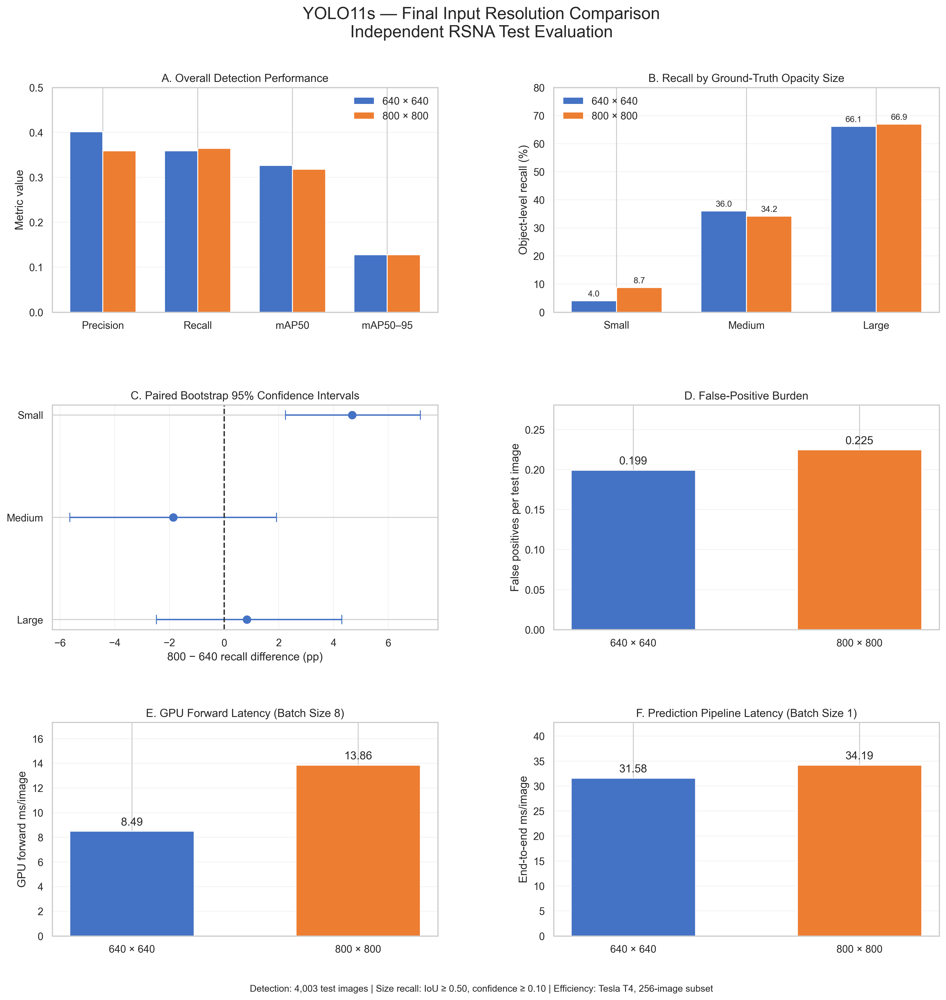
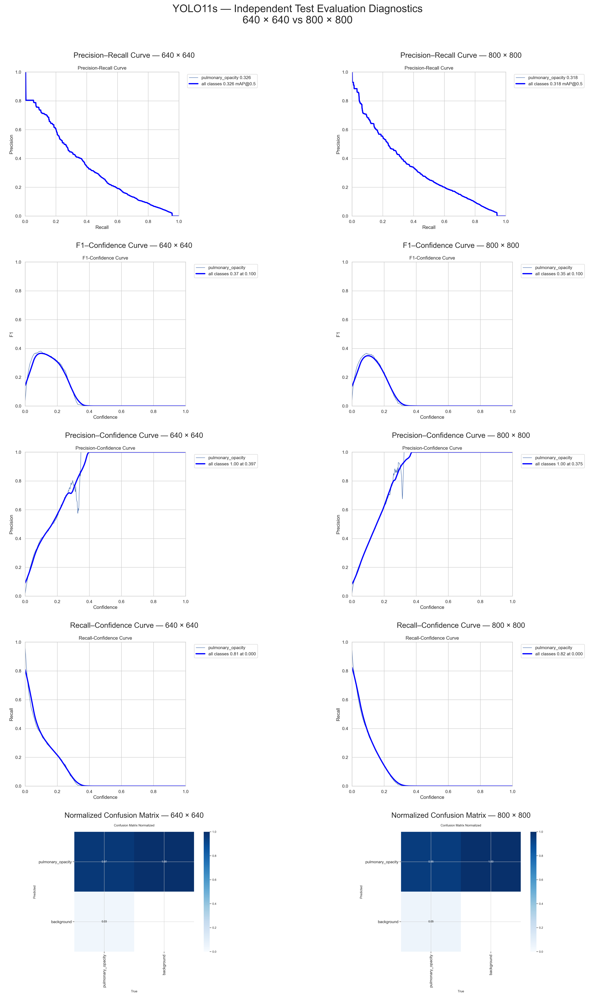
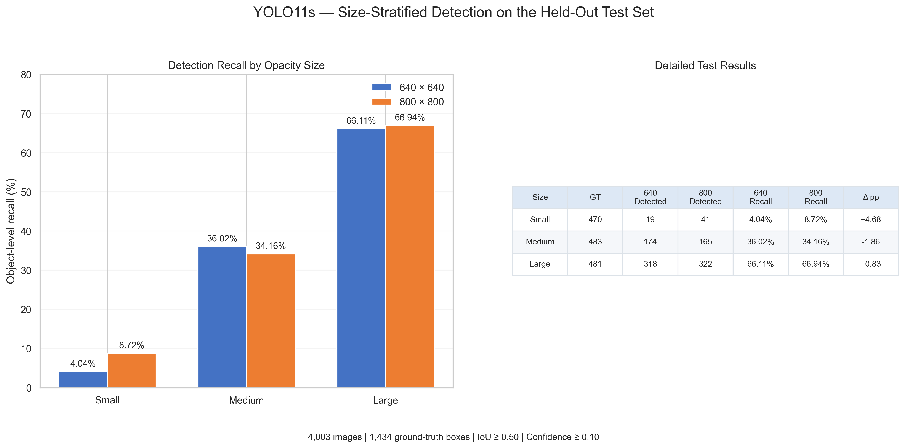
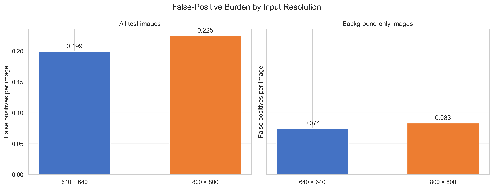
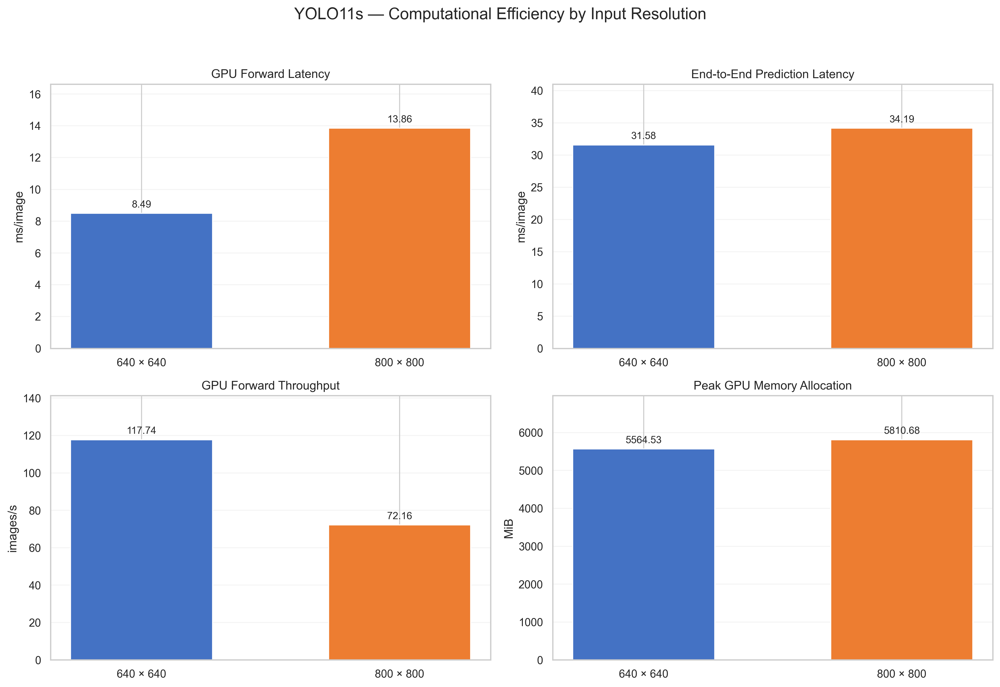

# Pulmonary Opacity Detection in Chest X-rays Using YOLO11
### An Input Resolution Study: 640 × 640 vs. 800 × 800

A controlled experimental study of **YOLO11s** for pulmonary opacity localization in chest radiographs, examining how input resolution affects **overall detection performance, recall across opacity sizes, false positives, and computational efficiency**.

> **Research status:** Experiments and analyses completed. This repository is an academic research record, **not a clinically validated diagnostic system**.

## Research objective

**Research question:** How does increasing YOLO11s input resolution from **640 × 640** to **800 × 800** affect pulmonary opacity detection, particularly for small opacities, and what computational trade-offs does it introduce?

To isolate the effect of input resolution, two pretrained YOLO11s models were trained with otherwise matched configurations and evaluated on the same independent test split.

## Key findings

- **Small-opacity recall:** increased from **4.04%** at 640 to **8.72%** at 800 (**+4.68 percentage points**; paired bootstrap 95% CI **[+2.24, +7.17] pp**).
- **Aggregate detection accuracy:** mAP@0.50:0.95 remained essentially unchanged (**0.1276** vs. **0.1278**).
- **False positives:** increased from **0.1991** to **0.2246 per test image** (**+12.8%**).
- **GPU forward latency:** increased by **63.16%**; end-to-end prediction latency increased by **8.27%** under the respective benchmark protocols.

**Interpretation:** Higher input resolution improved observed small-opacity sensitivity, but at the cost of additional false positives and computation. Absolute small-opacity recall remained low, and these findings do not establish clinical suitability.



## Dataset

The study uses **Stage 2** data from the [RSNA Pneumonia Detection Challenge](https://www.kaggle.com/competitions/rsna-pneumonia-detection-challenge).

| Partition | Images | Opacity-positive images | Annotated opacity boxes |
|:--|--:|--:|--:|
| Training (70%) | 18,678 | 4,209 | 6,684 |
| Validation (15%) | 4,003 | 902 | 1,437 |
| Test (15%) | 4,003 | 901 | 1,434 |
| **Total** | **26,684** | **6,012** | **9,555** |

The test set also includes **3,102 images without annotated opacity boxes**. Original DICOM images were converted to PNG, and bounding-box annotations were converted to YOLO format. The test partition was held out from training and checkpoint selection.

**Data availability:** The RSNA dataset is **not redistributed** in this repository. Access it through the original challenge, subject to its terms.

## Experimental setup

| Configuration | Value |
|:--|:--|
| Detector | Pretrained **YOLO11s** |
| Input sizes | **640 × 640** and **800 × 800** |
| Epochs | 30 |
| Training batch size | 8 |
| Optimizer | SGD |
| Initial learning rate | 0.01 |
| Momentum / weight decay | 0.937 / 0.0005 |
| Random seed | 42 |
| Deterministic mode | Enabled |
| Mixed precision | Enabled (`amp=True`) |
| Augmentation | Geometric, color, mosaic, mixup, and related augmentations disabled |
| Checkpoint selection | Highest validation mAP@0.50:0.95 |

Only **one training run per resolution** was performed. The study does not estimate variability across independently trained seeds.

### Evaluation protocols

**Overall detection:** Each best checkpoint was evaluated on the same held-out test partition using Ultralytics `model.val()` at its respective resolution (`conf=0.001`, NMS `iou=0.70`, batch size 8).

**Size-stratified recall:** Ground-truth boxes were assigned to small, medium, or large groups using **training-set tertiles of normalized bounding-box area**. The thresholds were **4.4132%** and **8.5382%** of image area. Object-level matching used prediction confidence **≥ 0.10**, box IoU **≥ 0.50**, and one-to-one matching.

**Uncertainty:** Differences between models (800 − 640) were estimated with **3,000 paired image-level bootstrap resamples** and percentile 95% confidence intervals.

**Efficiency:** Synthetic FP32 GPU forward passes were benchmarked at batch size 8; end-to-end predictions were benchmarked at batch size 1 on the same deterministic subset of **256 test PNGs**. These timings describe different workloads and should not be directly equated.

> **Metric distinction:** Ultralytics overall recall and the size-stratified object-level recall use different confidence and matching protocols. Their numerical values are **not interchangeable**.

## Results

### Overall held-out test performance

| Metric | YOLO11s-640 | YOLO11s-800 |
|:--|--:|--:|
| Precision | **0.4012** | 0.3590 |
| Recall (Ultralytics) | 0.3588 | **0.3643** |
| mAP@0.50 | **0.3264** | 0.3180 |
| mAP@0.50:0.95 | 0.1276 | **0.1278** |

The near-identical mAP@0.50:0.95 values indicate **no meaningful aggregate accuracy advantage** from increasing the resolution in this single-seed experiment.



### Recall by opacity size

| Ground-truth size | Test boxes | YOLO11s-640 | YOLO11s-800 | Difference (800 − 640) |
|:--|--:|--:|--:|--:|
| Small | 470 | 4.04% | **8.72%** | **+4.68 pp** |
| Medium | 483 | **36.02%** | 34.16% | −1.86 pp |
| Large | 481 | 66.11% | **66.94%** | +0.83 pp |



### Paired bootstrap confidence intervals

| Difference (800 − 640) | Estimate | 95% paired bootstrap CI |
|:--|--:|:--|
| Small-opacity recall | **+4.68 pp** | **[+2.24, +7.17] pp** |
| Medium-opacity recall | −1.86 pp | [−5.65, +1.91] pp |
| Large-opacity recall | +0.83 pp | [−2.47, +4.30] pp |
| False positives per test image | +0.0255 | [+0.0115, +0.0397] |
| False positives per background-only image | +0.0087 | [−0.0013, +0.0193] |

The interval for small-opacity recall is above zero **under test-image resampling**, but these intervals do **not** capture variation from retraining with different seeds.

### False positives and efficiency

| Metric | YOLO11s-640 | YOLO11s-800 | Change |
|:--|--:|--:|--:|
| False positives / test image | 0.1991 | 0.2246 | **+12.8%** |
| Synthetic GPU forward latency | 8.49 ms/image | 13.86 ms/image | **+63.16%** |
| End-to-end prediction latency | 31.58 ms/image | 34.19 ms/image | **+8.27%** |

The original benchmark evidence also includes throughput and peak allocated GPU memory. Performance figures are hardware- and workload-dependent.





## Repository structure

```text
pulmonary-opacity-detection-yolo11/
├── README.md
├── .gitignore
├── notebooks/
│   └── object-detection-project-final.ipynb
└── figures/
    ├── training_comparison/
    │   └── training_comparison.png
    ├── test_comparison/
    │   ├── test_confusion_matrices_comparison.png
    │   ├── test_diagnostics_comparison.png
    │   └── test_performance_curves_comparison.png
    ├── size_analysis/
    │   ├── false_positive_bootstrap_ci.png
    │   ├── false_positive_comparison.png
    │   ├── recall_bootstrap_ci.png
    │   ├── size_detection_outcomes.png
    │   ├── size_recall_comparison.png
    │   └── size_recall_interpretation.png
    ├── efficiency_benchmark/
    │   └── efficiency_comparison.png
    └── final_comparison/
        └── final_research_dashboard.png
```

**Main notebook:** [View the completed experiment and analysis](notebooks/object-detection-project-final.ipynb).

The initial public repository includes the notebook and selected research visualizations. **Machine-readable result archives, original RSNA data, and model checkpoints are not included.** The training outputs and trained checkpoints are preserved separately.

## Reproducibility

### Environment

The experiment was performed in a **Kaggle notebook** using Python, PyTorch, Ultralytics YOLO11, and scientific Python packages. 
The notebook installs Ultralytics with `%pip install -q ultralytics`.

### Reproduce the full experiment

To reproduce the complete workflow, obtain the RSNA Stage 2 dataset; perform the documented DICOM conversion, stratified splitting, and YOLO label preparation; train both configurations; evaluate the best checkpoints; and regenerate the per-image inference records, paired bootstrap analysis, and efficiency benchmarks.

## Limitations

- **Single seed:** One training run per resolution; no between-run uncertainty estimate.
- **Low absolute sensitivity for small boxes:** The 800-pixel model still detected fewer than one in ten small annotated boxes under the specified operating point.
- **Bootstrap scope:** Confidence intervals reflect paired resampling of test images, not new training runs or external populations.
- **Size definitions:** The small/medium/large categories are relative bounding-box-area tertiles, **not** clinical severity classes.
- **Generalizability:** Evaluation uses a single challenge dataset, without independent external clinical validation.
- **Efficiency context:** Measured latency depends on hardware, batch size, precision, and processing pipeline.
- **Clinical use:** This project is for **research and education only**; it must not be used for diagnosis or patient-care decisions.

## Acknowledgments

- [RSNA Pneumonia Detection Challenge](https://www.kaggle.com/competitions/rsna-pneumonia-detection-challenge) — dataset and challenge framework.
- [Ultralytics YOLO11](https://docs.ultralytics.com/) — detection implementation.
- [Kaggle](https://www.kaggle.com/) — computational notebook environment.


---

**Project:** *Pulmonary Opacity Detection in Chest X-rays Using YOLO11: An Input Resolution Study*  
**Focus:** Input resolution · Object detection · Size-stratified recall · Paired bootstrap · Computational efficiency
